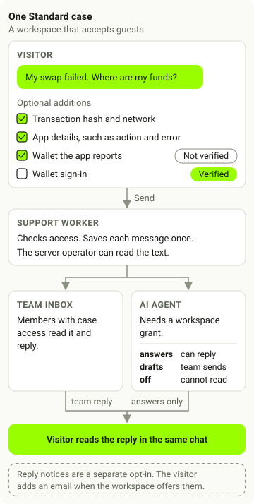

# Templ

Share a private support link and reply to visitors from one inbox. Add the widget if you want the same chat inside your app. Visitors can ask as guests. If your team enables wallet verification, visitors can also prove they control an address.

[Create your chat on Templ Hosted](https://usetempl.com/create) · [Self-host this source](docs/self-host.md)

This example shows what the team receives when a visitor chooses to include app details.



[How a message reaches the team, how retries work, and where AI joins](docs/support-delivery.md)

Run the chat simulations locally with `pnpm test:simulation`. If one fails, rerun it with the seed in the error message. To compare answers about Bitcoin, Ethereum, Solana and wallets, run the [crypto support benchmark](apps/scripts/src/support-agent/crypto-benchmark/README.md). Its example runs locally without a model account.

## Give visitors a way to reach you

| Choose | Set it up |
| --- | --- |
| **Standalone chat** | In a new hosted workspace, select **Open chat** and send a test question. Use **Copy chat link** to share the page. Select **Open inbox** and reply from **Cases**. For an existing workspace, open **Settings → Chat → Guest support**, select **Host a support page on Templ** when available, then **Save guest support** and **Copy support link**. |
| **Embedded widget** | In **Settings → Chat**, copy the install prompt for your workspace or follow the manual guide. Connect the widget to a Help button on your HTTPS site. Your app can offer the visitor a choice of details to share. |
| **Both** | Enable the support page and install the widget for the same workspace. Both reach the same team inbox. A visitor who follows the standalone link can describe the problem there. App context is available through the integration on the page where the problem happened. |

Try each entry point you plan to offer in a test workspace. Send a question, reply from the inbox, and reopen the original chat to read the reply. Use a private test destination for any staff alerts. [Hosted setup](https://docs.usetempl.com/install/) · [Manual widget guide](https://docs.usetempl.com/developers/widget/) · [Setup troubleshooting](https://docs.usetempl.com/install/troubleshooting/)

## What the visitor can share

- **Message.** A workspace can accept guests, ask for a wallet address, or require wallet sign-in. Guest support needs only a message.
- **Wallet proof.** The visitor signs a sign-in message to prove control of the wallet. The team sees that wallet as verified.
- **Reported address.** Your app can report the connected address without a signature. The visitor ticks a box to share it. A workspace that asks for an address shows it before Send. The team sees it as not verified.
- **Transaction and app details.** If your integration enables transaction details, the visitor can share up to five transaction hashes, the network, and details your app supplies, such as the action and error. The widget sends only the rows the visitor ticks.

Reply notices are a separate opt-in. The visitor can add an email when the workspace offers them.

[Widget setup and wallet options](https://docs.usetempl.com/developers/widget)

## Who can read messages

| Chat mode | Who can read the message text |
| --- | --- |
| Standard | The visitor, team members with case access and the server operator. If case policy allows AI, the authorized agent and the model provider it uses can process the input sent to them. |
| Customer-managed encryption | Approved participant devices and the workspace's own validation and recovery services. The workspace controls its keys and backups. Under the default customer-managed custody, Templ-hosted AI and Templ operators cannot read the message text. |
| Templ-operated encryption | Approved participant devices and Templ's validation and recovery services. This mode runs only on Templ's own support workspace. |

The two encrypted modes differ in who holds the keys. In both, the sender's client encrypts each message before it sends it. The relay stores ciphertext and still sees case and delivery metadata. The agent setup for Standard cases gives no access to encrypted cases. With Templ-operated encryption, an approved AI recipient can read messages when the case policy permits it.

A Standard case has an AI mode. In **AI answers**, an agent with workspace access can reply. In **AI drafts only**, the agent drafts or hands off, and a person sends the reply. **AI off** blocks the agent from the case. A reply from a person moves a case in AI answers to AI drafts only. The agent's model provider receives the text the agent sends.

[Encryption code](packages/e2ee) · [Hosted security and data](https://docs.usetempl.com/security)

## Try a complete conversation

Use Node 22.23.4 and pnpm 10.34.7.

```sh
pnpm install --frozen-lockfile --ignore-scripts
pnpm test:support
```

The check runs the support worker locally in Workerd with temporary test accounts. It sends a guest message, saves one authorized team reply, and reopens the chat to read both messages.

## Run it yourself or ask Templ to host it

**Self-host.** The [MIT license](LICENSE) covers Templ's code. You supply the runtime, storage, secrets, and domains. For customer-managed encryption, you also operate the key services. This source includes the [web app](apps/web), [support worker](apps/workers/community), and encryption code.

Run `pnpm build` to build the web app. For your deployment, set `NEXT_PUBLIC_TEMPL_SITE_ORIGIN` to your web origin and `NEXT_PUBLIC_TEMPL_API_ORIGIN` to your support worker. Set these values at build time. Your deployment also needs the worker's storage bindings and its own secrets. The public build starts with hosted features off. [Configure web origins, worker storage and chat access](docs/self-host.md)

This checkout verifies the local conversation check and the web build only. It includes no deployment configuration, and the worker rejects any `APP_ORIGIN` outside its built-in list, so your own domain needs a source change first. The guide explains both.

**Templ Hosted.** Enter your website and select **Preview your chat**. You can change the name, icon and color. Ask up to 25 free questions in the same chat your visitors will use. If the scanner can’t read your site, try a public docs page.

Practice questions go to Templ’s AI service. The conversation stays in the tab and your inbox stays empty. Select **Sign in to keep your workspace** when you’re ready. You can also choose **Set up without a website**. [Try it with your website](https://usetempl.com/create) · [Practice privacy](https://docs.usetempl.com/ai#practice-privacy)

The trial includes a working link, an inbox and 10 test tickets. To claim an available hosted name, enter the name under **Choose a hosted name** and select **Reserve name and choose a plan**. Both plans cover all seats. A case counts once when the visitor gets its first substantive answer. The trial limit and the prices below mirror [`plans.ts`](packages/chat/src/plans.ts) in this source.

| Per workspace | Starter | Plus |
| --- | ---: | ---: |
| Monthly price | $29 | $99 |
| Annual price | 290 USDC | 990 USDC |
| Answered cases included | 100 | 500 |
| Each additional case | $0.20 | $0.19 |
| Monthly AI credit | $5 | $20 |

Choose Starter or Plus at checkout. Pay the USDC amount shown on one of the offered networks. Pay monthly or cover 12 months in one payment. Included cases and AI credit reset monthly. Renew manually. Templ AI uses your included credit first. To spend more on Starter, add USDC and set a monthly spending limit. You can also connect your own AI provider. [Pricing](https://docs.usetempl.com/pricing/) · [Stablecoin payments](https://docs.usetempl.com/pricing/stablecoin-payments/)

[Connect your own knowledge sources and AI](docs/support-delivery.md#connect-ai)

[Source revision](SOURCE.json) · [Third-party notices](NOTICE)
