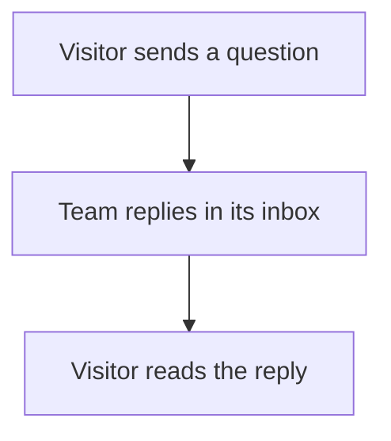

# Templ

A visitor opens Help in your app and sends a question. Your team replies from its inbox. The visitor reads the reply in the same chat.



[How a message reaches the team, how retries work, and where AI joins](docs/support-delivery.md)

## What crypto teams can see

- **Wallet status.** A workspace can accept guests or require a wallet. Wallet sign-in proves control. A wallet address supplied by the app is unverified.
- **Transaction details.** Visitors can choose to share a transaction hash, chain, and app or browser details. Your team can use those details to check what happened.
- **Reply email.** Visitors can add an email when the workspace offers reply notices. Guest support needs only a message.

[Widget setup and wallet options](https://docs.usetempl.com/developers/widget)

## Who can read messages

| Mode | Who can read the message text |
| --- | --- |
| Standard | The visitor and team members with access to the case. The server that runs the app can also read the text. |
| Customer-managed encryption | Approved participant devices and the workspace's own validation and recovery services. The workspace controls its keys and backups. |
| Templ-operated encryption | Approved participant devices and Templ's validation and recovery services on Templ's own support workspace. An approved AI recipient can read messages that the case policy permits. |

With encryption, the sender's client encrypts messages before it sends them. The relay still sees case and delivery metadata. In Standard mode, an AI integration can process eligible case content when the workspace enables it.

[Encryption code](packages/e2ee) · [Hosted security and data](https://docs.usetempl.com/security)

## Try a complete conversation

Use Node 22.23.4 and pnpm 10.34.7.

```sh
pnpm install --frozen-lockfile --ignore-scripts
pnpm test:support
```

The check starts a local Workerd instance with test credentials. It verifies that a guest can send a message, receive a team reply, and reopen the conversation.

## Run it yourself or ask Templ to host it

**Self-host.** The [MIT license](LICENSE) covers Templ's code. You supply the runtime, storage, secrets, and domains. For customer-managed encryption, you also operate the key services. This source includes the [web app](apps/web), [support worker](apps/workers/community), and encryption code.

Run `pnpm build` to build the web app. Set `NEXT_PUBLIC_TEMPL_SITE_ORIGIN` and `NEXT_PUBLIC_TEMPL_API_ORIGIN` to your own site and API origins. The public build starts with hosted features off.

**Managed.** Templ can run the service for you. [Talk to us](https://usetempl.com/) about hosting, integration, or support. [Hosted setup guide](https://docs.usetempl.com/install)

[Source revision](SOURCE.json) · [Third-party notices](NOTICE)
