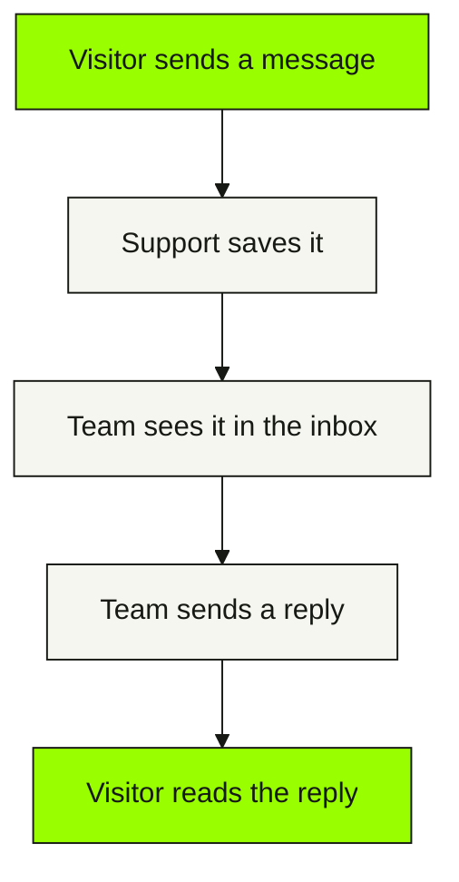
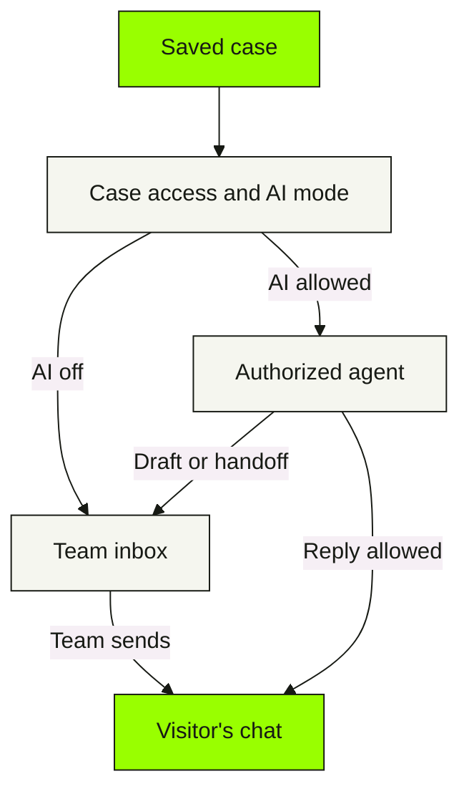

# How support messages travel

A visitor opens the widget inside your app or follows your workspace’s standalone support link. The team reads the message and replies in the same workspace inbox. The visitor can reopen the original conversation to read the reply. [Choose an entry point](../README.md#give-visitors-a-way-to-reach-you)

The widget keeps the message ID until the server confirms the send. The server checks access and saves the message. When you retry, the widget uses the same ID. The server returns the saved message. The conversation shows one copy. The visitor can reopen the conversation in a browser that still has access.

A team or AI reply can name the message it answers and its revision. If the conversation changes, read it again before replying.

See the [widget client](../apps/web/src/lib/support-widget-live.ts), [inbox](../apps/web/src/components/team-conversations.tsx), and [message storage and access checks](../apps/workers/community/src/team-conversations.ts). Run `pnpm test:support` after [installing the workspace](../README.md#try-a-complete-conversation) to test guest send, team reply, and resume with synthetic data.

## Where AI joins

The workspace grants its agent access. The case settings say what the agent can do. The agent can draft or reply when the settings allow it. AI off blocks the agent from reading the case. The team can reply while AI is off.

See the [agent client](../apps/web/public/agent-client.mjs), [AI case controls](../apps/workers/community/src/support-workflow.ts), and [managed agent](../apps/workers/community/src/managed-agent/runner.ts).

| Chat mode | Who can read the text |
| --- | --- |
| Standard | The visitor, the authorized team, and the server operator. An enabled agent can read eligible cases. Its model provider receives the text the agent sends. |
| Customer-managed encryption | Approved devices and key services that the workspace operates or designates. The workspace keeps its keys and backups. Templ cannot recover messages if the workspace loses every copy of its keys. The Standard agent setup below gives no encrypted case access. |
| Templ-operated encryption | On Templ's own support workspace, approved devices and Templ's key services. The approved AI recipient and its model provider can process text when the case permits it. |

For encrypted cases, the sender encrypts before transmission. The relay sees delivery metadata. See the [encryption implementation](../packages/e2ee) and [hosted data policy](https://docs.usetempl.com/security).

## Connect AI

**Templ-hosted.** Follow the [Templ AI setup guide](https://docs.usetempl.com/ai). Confirm that your workspace has access, add approved sources under **AI → Sources**, and grant the managed account the **AI support** role when prompted. Start with **AI drafts only**. Send a question answered by one of your sources and review its draft in the inbox.

**Your own agent.** Follow the [JavaScript setup](https://docs.usetempl.com/developers/support-agent) with a service wallet and the AI support role. Check `agents.sdkVerified` and `support.conversationsVerified` at `/api/status` on your app origin. Verify the client hash before importing it. Connect your model on your own server. Start with one page from your public docs or one approved FAQ in **AI → Sources**. Check that your agent can read that source. Send one Standard test question answered by the source and one outside it. Review the draft for the first and the handoff for the second before enabling replies. The [Agent API](https://docs.usetempl.com/developers/agent-api) lists the case, draft, and reply calls.
